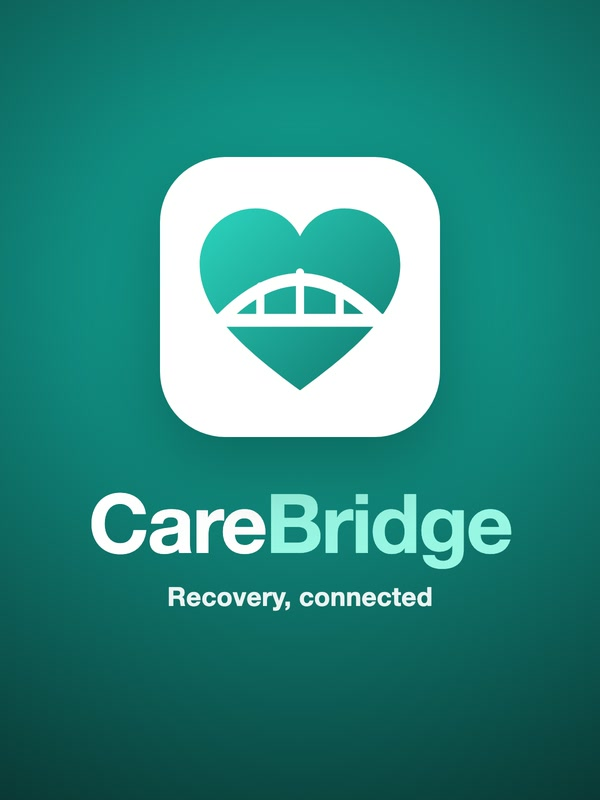

<p align="center"></p>

# CareBridge

An AI-driven clinical companion web app for patients recovering at home after a hospital stay, with a dashboard that keeps their care team informed between visits. Built in Frisco, Texas.

> **Prototype.** Use only fictional demo data. The app is built with HIPAA and Texas HB 300 safeguards in mind,
> but software alone can't make you compliant. That also takes a signed BAA with every vendor that touches PHI
> (including the AI provider), HTTPS hosting, a risk assessment, policies, and real staff training.
> The risk screening supports clinicians. It doesn't replace them, and it is not a validated medical device.

## Why

After surgery, patients go home with pages of instructions and new medications, and their doctor often hears nothing until the next appointment. CareBridge turns discharge papers into a daily plan, reminds patients when something is due, gives them a private journal, and keeps the care team updated, with safety checks for patients who may be in crisis.

## Features

| Area | What it does |
|---|---|
| Discharge photo → checklist | Claude vision reads printed or handwritten instructions into a Pydantic-validated schema. The patient reviews and edits, then it becomes a daily checklist. Items stay marked "awaiting review" until the provider approves them. |
| Journal + C-SSRS screen | Each entry is screened against the Columbia scale screener items. The **code**, not the AI, maps the answers to a risk level. If the AI is down, a keyword screen escalates so the screen never fails open. |
| Graduated escalation | low: flag. moderate: alert plus webhook. high/imminent: crisis screen for the patient and a high-priority webhook for SMS/email (plus a backup contact for imminent). Webhook payloads carry no clinical text. |
| Companion chatbot | Answers only from the patient's own care plan. It won't diagnose, change medications, or validate self-harm. Chat messages are risk-screened too. |
| Reminders | Web Push notifications at each item's scheduled time, plus an optional follow-up 30 minutes later if it's still not done. Lock-screen text has no medication names unless the patient opts in. Needs HTTPS (or localhost). |
| Provider dashboard | Adherence % per item, a mood trend, alerts with acknowledge/resolve, care-plan approval, and adding items. |
| HL7 FHIR R4 | Patient, Practitioner, CarePlan, MedicationStatement, adherence and mood Observations, and C-SSRS RiskAssessment. Download as a file, or POST a transaction Bundle to an EHR. |
| Security | Encrypted PHI fields (Fernet), HttpOnly + SameSite=Strict session cookie, strict CSP (no third-party scripts), CSRF tokens, 15-minute idle timeout, login rate limiting, role-based access, providers limited to their own patients, append-only audit log. |
| Texas HB 300 | Patient records available for instant download. Staff training log, with patient records locked until training is current. |

## Project layout

```
app.py                  Flask routes (patient, provider, admin)
carebridge/
  ai.py                 Claude calls: photo reading, C-SSRS screening, care-plan chatbot
  db.py                 SQLite schema and field-level encryption
  security.py           sign-in, roles, CSRF, security headers, audit log
  escalation.py         risk alerts and webhooks
  fhir.py               HL7 FHIR R4 export
  reminders.py          Web Push reminder scheduler
  seed.py               fictional demo data and demo sign-ins
  templates/ static/    pages, styles, scripts, service worker
tests/test_smoke.py     end-to-end smoke tests (no AI calls)
demo/                   cover image and demo script
```

## Getting started

Requires Python 3.10 or newer.

```bash
python3 -m venv .venv
.venv/bin/pip install -r requirements.txt
cp .env.example .env                 # add your ANTHROPIC_API_KEY for the AI features
.venv/bin/flask --app app seed       # load fictional demo data (sign-ins are listed in carebridge/seed.py)
.venv/bin/python app.py              # open http://127.0.0.1:5050
```

Run the tests:

```bash
.venv/bin/python tests/test_smoke.py
```

On first run the app adds `DATA_ENCRYPTION_KEY` and the reminder keys to `.env`. Back up `.env`: without it, the stored data can't be read. Without an API key, the app still runs. Journal screening falls back to the keyword check, and photo reading and the chatbot show a "service unavailable" message.

## Built with

Python, Flask, SQLite, the Anthropic Claude API, and Web Push. Developed with help from Claude Code, Anthropic's AI coding assistant.
